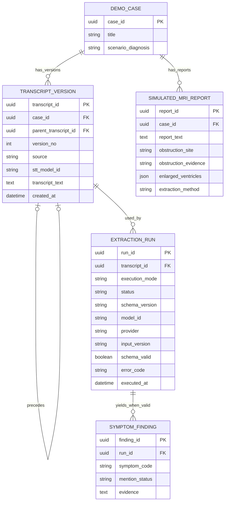

# medspeech-lab

한국어 가상 의료 상담의 STT 전사 품질과 구조화 오류 전파를 연구하는 실행 가능한 포트폴리오입니다. 진단·처방을 생성하지 않으며 실제 환자 데이터는 없습니다. 합성 음성 실험을 실제 진료 성능으로 일반화하지 않습니다.

두 경로를 분리합니다. `smoke`는 CPU에서 테스트 톤·스크립트 오류 전사·규칙 추출기로 데이터 QC, 지표, JSON, API를 확인합니다. 이 규칙 추출기는 LLM이 아니며 기본/근거 프롬프트를 구별하지 않습니다. `full`은 MMS Korean TTS, Whisper tiny, 같은 Whisper 체크포인트의 PyTorch LoRA, 로컬 Qwen LLM을 사용합니다. 실제 실행 상태와 수치는 [실험 보고서](reports/experiment_report.md)에 기록합니다.

실제 실행 결과: pytest 21개와 smoke 통과, 실제 합성 음성 36개 QC 실패 0, CPU LoRA 3 epochs 완료. 고정 테스트 6개에서 실제 CER는 A 36.56%, B 36.56%, C 31.90%였습니다. 로컬 Qwen의 JSON 통과율은 8개 조건 모두 0%여서 구조화 품질은 해결되지 않았습니다. API는 이런 모델 출력을 502로 거부하도록 구현되어 있습니다. 이 한계와 실패 원문을 보고서에 포함했으며, smoke 대역 모델의 성공을 실제 LLM 성능으로 제시하지 않습니다.

## 목차

- [설치 (Windows PowerShell)](#설치-windows-powershell)
- [뇌실 통로 폐쇄 가상 사례 데모](#뇌실-통로-폐쇄-가상-사례-데모)
- [전사 검토 및 수정](#전사-검토-및-수정)
- [API](#api)
- [데이터와 평가 규약](#데이터와-평가-규약)
- [코드와 산출물](#코드와-산출물)
- [Hugging Face 모델 연동](#hugging-face-모델-연동)
- [ERD](#erd)
- [DB 설계](#db-설계)
- [요구사항 정의서](#요구사항-정의서)

## 설치 (Windows PowerShell)

Python 3.11 또는 3.12, 디스크 여유 약 8 GB 이상을 권장합니다. CUDA는 필수가 아니지만 실제 학습과 LLM 추론은 CPU에서 느릴 수 있습니다. 아래 명령은 프로젝트 폴더에서 실행합니다. 활성화 스크립트를 사용하지 않아 실행 정책 변경이 필요 없습니다.

```powershell
py -3.12 -m venv .venv
.\.venv\Scripts\python.exe -m pip install --upgrade pip
.\.venv\Scripts\python.exe -m pip install -e '.[test]'
.\.venv\Scripts\python.exe -m pytest -q
.\.venv\Scripts\python.exe -m medspeech.cli smoke
```

## 뇌실 통로 폐쇄 가상 사례 데모

기존 FastAPI 앱에 로컬 단일 페이지를 추가했습니다. 서버를 시작한 다음 브라우저에서 [가상 사례 화면](http://127.0.0.1:8765/demo/aqueduct)을 여세요.

```powershell
.\.venv\Scripts\python.exe -m medspeech.demo serve --port 8765
```

기본 화면은 **수도관 폐쇄**와 **예시 전사문 · 모델 미실행** 상태입니다. 별도 모델 설치 없이 페이지와 예시 주석, 가상 판독문 근거를 확인할 수 있습니다. 정상 흐름 버튼은 측뇌실 → 제3뇌실 → 중뇌수도관 → 제4뇌실을 연결하며, 수도관 폐쇄 버튼은 압박 지점에서 화살표를 멈추고 상류 확장을 표시합니다. 개념도 상태와 입력의 추출 결과는 독립적입니다. 정상 흐름을 선택해도 가상 판독문 자체를 정상으로 바꾸지 않습니다.

**가상 MRI 판독문 숨기기**를 누르면 판독문 텍스트, 폐쇄 관련 위치, 확장된 뇌실 및 그 근거를 제거하고 ‘영상 정보 없음’을 표시합니다. 개념도와 시나리오 설정은 입력 소견과 구분되어 남습니다. ‘현재 사례 JSON 저장’도 숨김 상태를 반영합니다.

`medspeech/cases/aqueduct_obstruction.json`은 `reference_transcript`, `stt_transcript`, `simulated_mri_report`, `scenario_diagnosis`를 구분합니다. 기준 사례의 `stt_transcript`는 null이고, 실제 STT 호출이 완료된 경우에만 응답/실험 파일에 실제 문자열을 기록합니다. 원인 질환명은 시나리오 설정에만 있으며 STT·LLM의 입력에 전달하지 않습니다. 음성 결과는 증상만 노출하고, 영상 소견은 **가상 판독문 문자열 근거 · 규칙 기반**으로 표시합니다. MRI 이미지, 질환 후보 순위·확률, 치료 추천은 사용하지 않습니다.

실제 모델 연결은 기존 `WhisperAdapter`와 `LocalLLM`을 공유합니다. `[full]` 의존성을 설치하고 기존 SHA lock을 유지하세요. 배포물에는 이 한 발화의 TTS 합성 WAV와 출처 metadata가 포함됩니다. 다시 생성하거나 CLI에서 실제 실행 결과를 기록하려면:

```powershell
.\.venv\Scripts\python.exe -m pip install -e '.[test,full]'
.\.venv\Scripts\python.exe -m medspeech.demo generate-audio
.\.venv\Scripts\python.exe -m medspeech.demo run
# 판독문을 제공하지 않는 상태의 실제 실행 기록:
.\.venv\Scripts\python.exe -m medspeech.demo run --no-mri --output artifacts/demo/no_mri_run.json
```

UI의 ‘합성 음성으로 STT·LLM 실행’도 같은 경로를 호출합니다. `MEDSPEECH_MODE=smoke`인 서버는 대역 모델을 실제 STT로 표시하지 않고 모델 미실행 상태를 반환합니다. 모델 환경이 없거나 실행에 실패해도 예시 정답을 실제 출력으로 채우지 않습니다. LLM 스키마 오류 시 실제 STT는 유지하고 음성 구조화는 null로 반환합니다. `/demo/api/run`의 HTTP 200은 실행 상태 envelope 수신을 뜻하며, 구조화 성공은 반드시 `execution.structure == "completed"`로 판단합니다. 웹 요청은 사례 원음이나 전사를 파일로 저장하지 않고, `demo run` CLI만 가상 사례의 실험 기록을 저장합니다.

기본 데모의 초기 검증은 [실행·검증 보고서](reports/demo_report.md)에 정리했습니다. 당시 브라우저 검증은 정책 차단으로 미완료였으며, 2026-11-22 전사 비교 확장에서는 실제 브라우저 연결·클릭 검증도 완료했습니다([비교 기능 보고서](reports/comparison_report.md)). 선택적인 DOM 테스트는 Node.js와 개발 의존성이 필요합니다.

```powershell
npm install
npm run test:ui
.\.venv\Scripts\python.exe -m pytest -q
```

관리형 Windows의 Hugging Face symlink 검사 문제가 있으면 기존 복사 캐시 도구와 같은 `tools/run_demo_windows_copy_cache.py`를 사용하세요.

```powershell
.\.venv\Scripts\python.exe tools\run_demo_windows_copy_cache.py generate-audio
.\.venv\Scripts\python.exe tools\run_demo_windows_copy_cache.py run
```

### 전사 오류 비교

같은 페이지의 **전사 오류 비교** 영역에서 원본과 전사를 비교합니다. 넓은 화면에서는 두 열, 좁은 화면에서는 읽기 쉬운 세로 배열입니다. 서로 다른 문자 구간을 강조하고 두통·구토의 「있음 / 없음 / 언급 없음」과 근거 문구를 표시합니다. 비교용 원본은 `머리가 계속 아프고 구토는 안 했어요.`이며, 기존 긍정 발화·합성 음성을 덮어쓰지 않습니다.

- full 모델 의존성과 저장된 실제 실행 결과가 있으면 그 전사를 표시하고 **저장된 결과 · 현재 요청에서 재실행 안 함**을 알립니다. 실제 STT 실행 버튼으로 다시 실행할 수 있습니다.
- 모델 환경/실행 결과가 없으면 `머리가 계속 아프고 구토를 했어요.`를 **모의 전사 오류 · STT 미실행**으로 표시합니다. ‘모의 전사 오류 보기’ 버튼으로 언제든 이 예시를 선택할 수 있습니다. 이때 `stt_transcript`는 null입니다.
- 실제 구조화에는 기존 `LocalLLM`, `Consultation`, `grounded()`를 재사용합니다. 실패한 모델 결과는 null로 두고, 별도 **예시 정답 · 한정 문자열 주석 · 모델 결과 아님**으로 시연용 상태를 표시합니다. 예시에서는 두통 양쪽 있음, 구토 원본 없음/모의 전사 있음입니다.
- 직접 수정한 전사는 실제 STT로 표시하지 않습니다. 빈 전사는 ‘언급 없음’으로 채우지 않고 **빈 전사문 · 평가 불가**로 처리합니다. 규칙 주석은 이 가상 발화의 한정된 표현만 다루며, 일반 한국어 부정 해석이나 맞춤법 복원 모델이 아닙니다.
- 전사문 편집과 MRI 소견은 독립적입니다. 판독문을 끄면 기존 소견과 비교 JSON 모두 ‘영상 정보 없음’/null이고, **가상 시나리오 · 교육용 개념도**는 남습니다. 증상에서 폐쇄·종양 종류를 추정하지 않습니다.

```powershell
# full 설치 및 모델 SHA 설정은 위 절차와 동일합니다.
.\.venv\Scripts\python.exe -m medspeech.comparison generate-audio
.\.venv\Scripts\python.exe -m medspeech.comparison run
.\.venv\Scripts\python.exe -m medspeech.demo serve --port 8765
# 선택적 Windows 복사 캐시 경로:
.\.venv\Scripts\python.exe tools\run_comparison_windows_copy_cache.py run
```

비교용 합성 음성은 `data/demo/comparison_patient.wav`, 실제 결과는 `artifacts/comparison/model_run.json`에 기록합니다. 웹 요청은 새 결과를 파일로 보관하지 않습니다. CLI만 가상 사례의 실험 기록을 저장합니다. [전체 검증·실제 모델 실행 범위](reports/comparison_report.md)와 [화면 예시](reports/comparison-preview.jpg)를 확인하세요.

실제 모델 설치와 데이터 생성·QC·학습·평가 순서:

```powershell
.\.venv\Scripts\python.exe -m pip install -e '.[test,full]'
$env:HF_HOME = Join-Path (Get-Location) '.cache\huggingface'
.\.venv\Scripts\python.exe -m medspeech.cli full --stage generate
.\.venv\Scripts\python.exe -m medspeech.cli qc --data .\data\full
.\.venv\Scripts\python.exe -m medspeech.cli full --stage train
.\.venv\Scripts\python.exe -m medspeech.cli full --stage evaluate
# STT 예측·체크포인트가 있고 LLM 평가만 다시 실행할 때:
.\.venv\Scripts\python.exe -m medspeech.cli full --stage structure
# 위 세 단계를 한 번에 실행하려면:
.\.venv\Scripts\python.exe -m medspeech.cli full
```

최초 모델 버전은 Hugging Face에서 commit SHA를 조회해 `artifacts/full/model_revisions.json`에 고정합니다. 재현 시 이 파일을 보존하세요. 실행 설정은 `configs/full.json`, 환경은 `artifacts/*/environment.json`에 저장됩니다. full 실패 시 `artifacts/full/failure.json`에 실제 예외가 남습니다. 설정 변경 시 기존 결과를 다른 폴더로 보존하고 `--base`로 복사한 프로젝트를 지정하세요. 기본 데이터 생성은 같은 데이터 버전 경로를 덮어쓰므로 검수 수정 데이터는 별도 버전으로 관리하세요.

관리형 Windows에서 Hugging Face의 symlink 임시 디렉터리 검사에 PermissionError가 발생하면 `python tools\run_windows_copy_cache.py full`로 동일 실험을 파일 복사 캐시 방식으로 실행할 수 있습니다. 이 스크립트는 모델·평가 코드를 바꾸지 않습니다. 실제 호스트의 설치 우회 및 명령 기록은 `reports/execution_log.md`를 참조하세요.

## 전사 검토 및 수정

같은 `/demo/aqueduct` 화면에서 기준 발화, 고정된 초기 전사·결과, 편집 가능한 수정문을 비교합니다. 초기 전사문을 복사해 편집을 시작하고 **수정문 재분석**으로 수정문만 기존 구조화 모듈에 전달합니다. 재편집 후 분석 전에는 결과에 **이전 수정문 기준**과 당시 입력을 표시합니다. 빈 수정문은 재분석할 수 없습니다.

```powershell
.\.venv\Scripts\python.exe -m medspeech.demo serve --port 8765
Start-Process 'http://127.0.0.1:8765/demo/aqueduct'
# 실제 수정문 LLM 실행 기록 (full 설치·모델 캐시 필요)
.\.venv\Scripts\python.exe -m medspeech.review run
# 모델 없이 지정된 긍정/부정 문장만 시연
.\.venv\Scripts\python.exe -m medspeech.review run --example --output artifacts/review/example_run.json
```

화면의 **모의 검토 시연 · 모델 미실행 → 구토 부정 수정 예시 채우기 → 수정문 재분석**을 누르면 두통 있음→있음, 구토 있음→없음을 각 입력 근거와 확인할 수 있습니다. **모의 전사문 · STT 미실행**, **예시 결과**는 실제 모델 결과와 구분합니다. 임의의 문장에는 예시 값을 생성하지 않습니다. 실제 스키마 오류는 **재분석 실패**로 표시하며 재시도할 수 있습니다. 이전 성공 결과가 있으면 그 입력 기준을 붙여 유지합니다.

MRI 판독문과 개념도는 전사 수정에 영향받지 않습니다. MRI를 숨기면 영상 소견·근거와 표시 JSON에서 제거합니다. 웹 요청은 수정문을 지속 저장하지 않으며 CLI만 가상 실험 JSON을 저장합니다. 이번 실제 Qwen 실행은 schema_error였고 STT는 재실행하지 않았습니다. 검증·한계·실행 명령은 [review_report.md](reports/review_report.md)에 기록했습니다.

## API

```powershell
$env:MEDSPEECH_MODE = 'smoke'
.\.venv\Scripts\python.exe -m uvicorn medspeech.api:app --host 127.0.0.1 --port 8000 --no-access-log
```

다른 PowerShell에서:

```powershell
curl.exe -X POST 'http://127.0.0.1:8000/infer' -F 'file=@data/smoke/audio/clean/s00-clean.wav;type=audio/wav'
```

실제 로컬 모델은 full 데이터 생성으로 SHA lock 파일을 만든 뒤 `$env:MEDSPEECH_MODE = 'full'`로 서버를 시작합니다. 기본 mode도 full입니다. `/infer`는 WAV MIME과 실제 헤더, 10 MiB, 모노 16 kHz, 길이 0초 초과 30초 이하, 유한 샘플을 검사합니다. 잘못된 입력은 413/415/422, 준비되지 않은 full 모델은 503, 스키마·근거 불합격은 502입니다. 응답에는 모델 이름, 모드, 전사, Pydantic 구조화 결과, 단계별 시간과 RTF가 포함됩니다. `/docs`에서 스키마를 확인할 수 있습니다.

서버는 원음·전사를 애플리케이션 파일이나 로그에 저장하지 않습니다. 업로드는 Starlette의 요청 임시 저장소를 거칠 수 있으며 요청 종료 시 닫힙니다. 요청 크기 상한은 파싱 후 파일 읽기에도 적용됩니다. 인터넷 공개 배포에는 프록시의 전체 요청 크기 제한·인증·동시성 제어가 추가로 필요합니다. 실험 배치 경로는 가상 데이터와 예측을 의도적으로 저장합니다. API 정책과 구분합니다.

## 데이터와 평가 규약

12개 시나리오/원문 × 3개 변형 = 36개 샘플. 시나리오 8/2/2개를 train/validation/test로 고정하여 각각 24/6/6개입니다. 동일 원문·시나리오와 모든 변형은 한 분할에만 있습니다. clean, 백색잡음 20 dB SNR, 1.1배 리샘플링(피치도 변화)을 구분합니다. 음성 경로·정답·핵심 용어·구조화 정답·화자·변형·버전·검수 상태는 JSONL manifest에 기록합니다. TTS 단일 화자 중복을 보고하며 화자 분리 성능을 주장하지 않습니다. 자동 QC 후 청취 검수는 미완료 상태로 남습니다.

MMS의 숫자 토큰 소실을 피하기 위해 `verbalize.py`에서 수치(38.2→삼십팔 점 이), 단위(mg→밀리그램), 약어(MRI→엠알아이)를 발음 문자열로 바꿉니다. 그 결과를 `tts_input`에 남기며 원래 전사 정답은 보존합니다. CER는 숫자 표기와 한국어 읽기의 차이도 오류로 세므로 정서법 차이에 민감합니다. 이를 임상적 수치 오류와 동일시하지 마세요. 발음 렌더러는 0~9999 및 소수만 지원하며 범위를 벗어나면 실패합니다.

* CER: NFKC, 소문자화, 문장부호 제거(소수점·슬래시·% 유지), 연속 공백 정리 후 공백을 제거한 문자 단위 micro edit distance / 정답 문자 수.
* WER: 동일 정규화 후 공백 기준 어절 토큰. 형태소 분석 WER가 아닙니다. 숫자를 한국어 읽기로 바꾸거나 부정을 삭제하지 않습니다.
* 의료용어 F1: 평가 정답 key_terms의 어휘 집합에 대해 전사 내 문자열 존재를 세는 micro F1. 복합어 부분 일치와 어휘 밖 환각을 포괄하지 못합니다.
* 숫자·단위 일치율: 추출한 숫자/단위 문자열 multiset의 샘플별 정확 일치. 임상 수치 의미 동치나 단위 변환은 적용하지 않습니다.
* 부정 일치율: 정답의 명시적 부정 근거 구문이 모두 보존된 샘플 비율. 새로운 부정의 추가 여부까지 포괄하는 의미 판별기는 아닙니다.
* LLM: 동일 모델/스키마, basic/grounded × gold/A/B/C 전사. strict JSON 통과율, 필드별 `(value, unit)` micro F1, 원문 근거 포함·값 포함 비율, 원문에 없는 값/단위 생성률을 별도로 계산합니다. 스키마 실패는 빈 예측으로 채점하며 오류 원문을 보존합니다. 근거/원문 밖 생성률의 분모는 스키마를 통과해 파싱된 추출 항목 수이며, 스키마 실패 출력의 환각을 포함하지 않습니다. 근거 일치는 인과적 정당성/정확한 부정 해석을 보증하지 않습니다. 분모가 0인 항목 비율은 0입니다.

test의 조건별 ID는 metrics.json에 저장됩니다. 잡음·발화 유형별 `n`을 함께 보고합니다. 테스트를 후처리 fitting에 전달하면 예외가 발생합니다. 사전은 train/dev 가설에서 실제 관측된 용어 내부 공백만 고치므로 테스트에서 개선이 없을 수 있습니다.

기본 로컬 LLM은 CPU에서 PyTorch Linear 동적 INT8 양자화를 적용합니다(`llm_cpu_int8=true`). GPU에서는 원래 가중치를 사용합니다. 모델 ID/SHA와 양자화 여부를 함께 기록하며, 프롬프트 비교는 같은 실행의 같은 LLM 설정 안에서 수행합니다. FP32와 INT8의 정확도·속도를 동일 조건으로 간주하지 않습니다.

LLM은 최대 256 tokens를 생성합니다(train/dev 정답은 동일 tokenizer에서 120~129 tokens). 중복 입력+동일 프롬프트는 같은 greedy 모델의 출력을 재사용합니다. 정확도는 모든 고정 테스트 샘플에 계산하고, 지연시간 배열에는 새로 생성한 호출만 기록합니다. `generation_calls`, `cache_hits`와 예측별 `cache_hit`으로 분모를 확인할 수 있습니다. B가 A와 같은 전사이면 별도의 LLM 지연시간을 주장하지 않습니다.

`llm_fail_fast_json=true`는 첫 비공백 문자가 `{`가 아니면 생성을 중단합니다. 엄격한 JSON 객체 파서는 이런 접두사 뒤에 무엇을 생성해도 통과하지 못하므로 유효 JSON을 거부하지 않는 검사입니다. 결과를 고치거나 진짜 JSON처럼 감싸지 않습니다. 저장 raw는 이 경우 전체 완성문이 아닌 실패 접두사이며, 지연시간도 실패 조기 중단을 포함한 실제 파이프라인 시간입니다. 전체 자유 생성 시간과 구분하세요.

## 코드와 산출물

| 경로 | 역할 |
|---|---|
| `medspeech/data.py` | 가상 정답, TTS/테스트 톤, 변형, 분할, QC CSV |
| `medspeech/schema.py` | 값·근거·수치 단위의 엄격한 JSON 스키마 |
| `medspeech/adapters.py` | 실제/대역 STT·LLM·TTS, prompt, SHA 고정, 후처리 |
| `medspeech/training.py` | PyTorch AdamW LoRA, 검증 loss 기반 best, 체크포인트/로그 |
| `medspeech/metrics.py` | 편집거리, 용어/수치/부정, 구조화 평가 |
| `medspeech/runner.py`, `cli.py` | smoke/full 실행과 환경·예측·지연시간 저장 |
| `medspeech/api.py` | 업로드 검증, 추론, JSON/근거 검증, 보관 금지 |
| `tests/` | 누수, QC 결함, CER, JSON/환각, 후처리, API 오류 테스트 |
| `data/smoke/` | 실행된 fixture manifest, WAV, QC CSV/요약 |
| `artifacts/smoke/` | 실제 smoke 계산 결과·예측·환경·API 증거 |
| `artifacts/full/` | 실제 LoRA 체크포인트·로그, STT/LLM 예측·지표·지연시간·모델 SHA |
| `reports/` | 연구 보고서, 업무 매핑, 라이선스, QC 예시, 실행 기록 |

MMS 음성 사용·공유 조건은 [data_license.md](reports/data_license.md), 오류 검수 기준은 [qc_examples.md](reports/qc_examples.md)를 확인하세요. [Whisper 모델 카드](https://huggingface.co/openai/whisper-tiny), [Qwen 모델 카드](https://huggingface.co/Qwen/Qwen2.5-0.5B-Instruct)의 모델 명칭·라이선스를 확인했습니다.

## Hugging Face 모델 연동

### 모델별 역할과 처리 흐름

| 우선순위 | 모델 | 역할 |
|---|---|---|
| 1 | `Qwen/Qwen3-32B` + `huggingface_hub.InferenceClient` | 한국어 전사문에서 두통·구토의 언급 상태와 원문 근거를 JSON으로 추출 |
| 2 | `openai/whisper-large-v3-turbo` | 동일한 가상 음성을 전사하여 기존 LoRA STT와 비교 |

처리 흐름은 **가상 음성 → 기존 LoRA STT 또는 Whisper Turbo → 초기 전사문 또는 검토자 수정문 → Qwen 증상 추출 → 서버 검증 → 결과 표시**입니다. 가상 MRI 소견은 별도의 **가상 판독문**에서 문자열 근거로 가져옵니다. 음성 증상에서 MRI 소견이나 시나리오 질환을 추론하지 않으며 Qwen에 MRI·질환 설정을 보내지 않습니다.

**구현됨:** 같은 데모의 「수정문 재분석」과 「초기 전사문 Qwen 분석」은 기본적으로 `huggingface_hub.InferenceClient`를 통해 `Qwen/Qwen3-32B`에 연결됩니다. 기존 로컬 Qwen2.5 실험 및 `/infer` 경로는 유지됩니다. 위의 이전 실험 결과는 새 Qwen3의 성능이 아닙니다. `MEDSPEECH_REVIEW_BACKEND=local`을 명시하면 기존 로컬 구조화 경로를 선택할 수 있습니다.

제공자는 `deepinfra`를 기본값으로 사용합니다. [공식 Structured Outputs 문서](https://huggingface.co/docs/inference-providers/guides/structured-output)의 `response_format=json_schema`와 strict 스키마 방식을 적용했습니다. [Qwen 모델 페이지](https://huggingface.co/Qwen/Qwen3-32B)와 [공식 Hub API](https://huggingface.co/docs/inference-providers/hub-api)를 확인하고, 공개 `https://router.huggingface.co/v1/models` 응답에서 이 모델의 DeepInfra가 `live`, `supports_structured_output=true`인 것을 확인했습니다. 문서 예시의 Cerebras를 현재 지원 제공자로 가정하지 않습니다. 호출 직전에도 모델·제공자·Structured Outputs 지원을 검사하며 자동으로 다른 모델이나 제공자로 우회하지 않습니다. 서비스 가용성은 변할 수 있습니다.

### 환경변수와 설치·실행

설정 예시는 [configs/hf.env.example](configs/hf.env.example)입니다. **HF_TOKEN은 빈 값**으로 제공하며 실제 토큰을 파일에 기록하지 않습니다. 앱은 `.env`를 자동으로 읽지 않으므로 아래 PowerShell 명령으로 서버 프로세스 환경을 설정합니다. 이번 문서 작업에서는 모델을 재실행하지 않았으며 검증 상태는 기존 실행 파일에 근거합니다.

| 환경변수 | 기본값 또는 설정 방법 | 실제 읽는 위치 |
|---|---|---|
| `HF_TOKEN` | 기본 없음. 서버에서 비공개 입력; 누락 시 `token_missing` | `medspeech/hf_models.py:HFQwen.analyse`; worker가 서버 환경을 상속 |
| `HF_LLM_MODEL` | `Qwen/Qwen3-32B` | `medspeech/hf_models.py:HFQwen.__init__` |
| `HF_LLM_PROVIDER` | `deepinfra` | `medspeech/hf_models.py:HFQwen.__init__` |
| `HF_CLIENT_PYTHON` | 기본 없음. 기존 full 서버에서는 `.venv-hf` Python의 절대 경로 지정 | `medspeech/hf_models.py:HFQwen.analyse`; 지정 시 분리 worker 실행 |
| `MEDSPEECH_REVIEW_BACKEND` | `hf`; `local`로 기존 로컬 구조화 선택 | `medspeech/api.py:create_app` (테스트 주입 인자는 별도) |
| `MEDSPEECH_MODE` | `full`; `smoke`는 실제 모델 호출 차단 | `medspeech/api.py:create_app`, 검토·STT 라우트 |
| `MEDSPEECH_LORA_PATH` | 미설정 시 `artifacts/full/checkpoints/best` | `medspeech/stt_compare.py:load_stt` |
| `HF_TURBO_REVISION` | 미설정/빈 값이면 Hub에서 SHA 조회 후 결과에 기록 | `medspeech/stt_compare.py:load_stt` |
| `HF_HOME` | 선택적인 모델 캐시 경로 | Hugging Face 라이브러리에서 사용; 위 기존 full 설치 명령 참조 |

```powershell
.\.venv\Scripts\python.exe -m pip install -e '.[test,full]'
# HF SDK는 기존 Transformers/LoRA 환경과 분리합니다.
py -3.12 -m venv .venv-hf
.\.venv-hf\Scripts\python.exe -m pip install -e '.[hf]'
$env:HF_CLIENT_PYTHON = (Resolve-Path '.\.venv-hf\Scripts\python.exe').Path
$env:HF_LLM_MODEL = 'Qwen/Qwen3-32B'
$env:HF_LLM_PROVIDER = 'deepinfra'
$env:MEDSPEECH_REVIEW_BACKEND = 'hf'
$env:MEDSPEECH_MODE = 'full'
# 토큰은 서버 PowerShell에서만 입력합니다. 실제 값을 명령 이력에 적지 않습니다.
$secret = Read-Host 'HF_TOKEN (Inference Providers 권한)' -AsSecureString
$env:HF_TOKEN = [System.Net.NetworkCredential]::new('', $secret).Password
.\.venv\Scripts\python.exe -m medspeech.demo serve --port 8765
```

`http://127.0.0.1:8765/demo/aqueduct`에서 초기 전사 분석과 수정문 재분석을 각각 실행합니다. 전송하는 사용자 입력은 교육용 전사문 하나뿐이며 가상 MRI·질환 설정은 프롬프트에 포함하지 않습니다. 토큰은 서버의 `HF_TOKEN`만 읽고 응답·브라우저·실험 로그에 담지 않습니다. 웹 요청은 전사문을 지속 저장하지 않습니다. 공개 서비스가 아닌 로컬 가상 사례 데모 용도로 사용하세요.

`hf` extra는 DeepInfra 지원을 확인한 `huggingface_hub==1.24.0`을 사용합니다. 기존 Transformers 4.49의 `huggingface-hub<1` 요구와 충돌하므로 `full,hf`를 같은 환경에 설치하지 마세요. `HF_CLIENT_PYTHON`이 지정되면 서버는 해당 Python의 `medspeech.hf_worker`에 전사문만 표준입력으로 전달합니다. 토큰은 상속된 서버 환경변수로만 전달하며 명령 인자에 포함하지 않습니다. 모델 응답은 서버에서 다시 검증합니다. STT가 필요 없는 별도 `.[hf]` 서버는 이 변수 없이 최신 클라이언트를 직접 사용할 수도 있습니다. 오래된 SDK만 있는 서버는 `client_unavailable`로 표시하며 조용히 다른 경로로 전환하지 않습니다.

출력은 필수 고정 키 `headache`, `vomiting` 각각의 `mention_status`와 `evidence_text`입니다. `present`/`absent`/`not_mentioned`를 화면의 「있음」「없음」「언급 없음」으로 표시합니다. 앞의 두 상태에는 증상과 긍정·부정 구절을 그대로 인용하고, 미언급 근거는 null입니다. 기존 `Consultation`, `Evidence`, `grounded()` 계약을 재사용하면서 외부 출력용 `TwoSymptoms` 스키마를 추가했습니다. 서버는 추가·누락·중복 JSON 키, null 규약, 입력에 없는 근거, 증상 이름 없는 근거 및 제한적인 한국어 부정 충돌을 거부합니다. 이 검사는 모든 한국어 문장의 의미 정확성을 보장하지 않습니다. 스키마 통과(`schema_valid`)와 실험 정답 일치(`symptom_states_correct`)는 별도로 기록합니다.

각 결과에는 `run_id`, `input_version`(입력 종류 + 본문 SHA256), `llm_model`, `provider`, `schema_version=two-symptoms-v1`, 실행 상태·오류 코드가 포함됩니다. 초기 전사·수정문·STT별 입력을 구별하며, 해시는 DB의 영구 버전 번호나 동일 본문의 개별 편집 이벤트 ID를 대체하지 않습니다. `token_missing`, `provider_unsupported`, `provider_check_failed`, `client_unavailable`, `call_failed`, `schema_error`, `grounding_error`, `content_error`를 화면에서 구별합니다. 실패는 성공 결과로 채우지 않습니다. **모의 검토 시연**은 별도의 **모의 결과 · 예시 결과 · 모델 미실행** 경로이며, 실제 HF 모드로 돌아가려면 페이지를 새로고침합니다.

### STT 모델 선택과 재현

**구현됨:** 「STT 모델 비교 · 같은 가상 음성」에서 기본값 **기존 LoRA STT**와 **Whisper Turbo**를 선택합니다. 각각 실행하면 두 결과가 보존되고 모델명·전사·CER·입력 버전을 따로 보여줍니다. 양쪽은 `data/demo/comparison_patient.wav`의 같은 바이트(SHA256 포함)를 읽고, 해당 음성의 메타데이터가 부정 기준 발화와 일치하는지도 확인합니다. 한국어 전사를 `language=ko`, `task=transcribe`로 강제하고 기존 `metrics.normalize`와 `distance`로 공백 제외 CER를 계산합니다. 기준·실제 모델·미실행 결과를 섞지 않습니다.

- LoRA: `configs/full.json`의 Whisper와 `artifacts/full/checkpoints/best`를 실제로 연결합니다. 체크포인트가 없으면 미실행이며 기본 모델로 몰래 대체하지 않습니다. `MEDSPEECH_LORA_PATH`로 경로를 바꿀 수 있습니다.
- Turbo: [openai/whisper-large-v3-turbo 공식 모델](https://huggingface.co/openai/whisper-large-v3-turbo)을 로컬 PyTorch로 실행합니다. 첫 실행은 대용량 모델 다운로드와 메모리가 필요합니다. `HF_TURBO_REVISION`으로 SHA를 고정할 수 있고 실제 사용한 SHA를 결과에 남깁니다.
- 각 전사 아래의 Qwen 분석 버튼은 동일 `/demo/api/review/reanalyse`로 연결됩니다. 양쪽 분석이 성공한 경우에만 두통·구토 상태를 비교합니다. 미실행 모델은 전사·CER가 null이며 「미실행」으로 표시합니다.

```powershell
# 지정 가상 긍정/부정 문장 두 개를 실제 HF에 요청하고 검증 기록 저장
.\.venv\Scripts\python.exe -m medspeech.hf_demo --output artifacts/hf/verification.json
# 같은 WAV로 LoRA와 Turbo를 실제 실행하고 각각 Qwen 구조화까지 요청
.\.venv\Scripts\python.exe -m medspeech.hf_demo --stt both --output artifacts/hf/verification.json
# 테스트 (외부 호출 없는 모의 응답 검증 포함)
.\.venv\Scripts\python.exe -m pytest -q
npm run test:ui
```

현재 실행 결과와 실제 호출 범위는 [HF 연결 검증 보고서](reports/hf_report.md) 및 `artifacts/hf/verification.json`을 확인하세요. HF_TOKEN이 없는 환경의 Qwen 실제 추출은 **미검증**이며 모의 응답 테스트를 실제 성능으로 제시하지 않습니다.

### 검증 결과와 실행 상태

아래 모의 응답은 `artifacts/hf/mock_validation.json`과 `tests/test_hf_models.py`에 근거합니다. 각 문장의 두통 기대값은 `present`(있음)이며, 구토 기대값은 각각 `present`(있음)와 `absent`(없음)입니다. 스키마 통과와 증상 정답 일치는 별도 항목입니다.

| 입력 / 검증 대상 | 응답 출처·실행 상태 | JSON 스키마 통과 | 증상 상태 일치 | 근거 |
|---|---|---|---|---|
| 「머리가 계속 아프고 구토를 했어요」 | 모의 응답 · 실제 Qwen 미실행 | 통과 | 두통 있음·구토 있음 일치 | `artifacts/hf/mock_validation.json` 첫 결과 |
| 「머리가 계속 아프고 구토는 안 했어요」 | 모의 응답 · 실제 Qwen 미실행 | 통과 | 두통 있음·구토 없음 일치 | `artifacts/hf/mock_validation.json` 두 번째 결과 |
| 같은 긍정/부정 발화의 실제 Qwen 요청 경로 | `unavailable / token_missing` · 실제 추론 미검증 | 미측정 (null) | 미측정 (null) | `artifacts/hf/verification.json:qwen` |
| 입력에 없는 근거 구절 | 모의 응답 · `grounding_error`로 거부 | 통과 가능; 실행 성공과 별개 | 실패 처리·검증된 증상 결과 없음 | `tests/test_hf_models.py:test_reject_invalid_output`, `test_review_api_hf_input_versions_and_failure_flags` |
| 증상 키 누락·중복·추가 | 모의 응답 · `schema_error`로 거부 | 실패 | 평가 대상 아님·증상 결과 없음 | `tests/test_hf_models.py:test_reject_invalid_output` |

제공자 검증은 **DeepInfra**로 수행했습니다. 공개 지원 정보는 `artifacts/hf/provider_check.json`에 저장되어 있고, SDK 1.24.0의 실제 요청 생성에서 `json_schema`, `strict=true`를 확인했습니다(`artifacts/hf/client_sdk_check.json`). SDK 응답은 가로챈 모의 응답이므로 인증된 실제 Qwen 호출 성공을 뜻하지 않습니다. UI는 실제 STT 실행, 모의 결과, 미실행, 호출 실패, 스키마·근거·내용 검증 실패를 구분하며 해당 입력 버전과 모델을 표시합니다.

| 실험 구분 | 실제 실행 범위 | 측정 결과 | 해석 범위 |
|---|---|---|---|
| 기존 학습·고정 테스트 실험 | Whisper tiny LoRA, 테스트 6개 | C의 CER **31.90%**, 기존 Qwen2.5 JSON 통과율 **0%** (8개 조건 모두) | 기존 실험 수치 그대로 보존; Qwen3/Turbo 지표가 아님 |
| 새 STT 비교 · 기존 LoRA | 가상 WAV 1건, 4.144초 | CER **43.75%**, 전사 **1.288초**, RTF **0.311** | `artifacts/hf/verification.json:stt`; 기존 normalize·공백 제외 CER |
| 새 STT 비교 · Whisper Turbo | 위와 동일한 WAV 1건 | CER **6.25%**, 전사 **176.071초**, RTF **42.488** | CPU·워밍업 없음·모델 로딩 제외. 실제 진료 성능으로 일반화하지 않음 |
| 새 Qwen3 구조화 | 토큰 누락으로 추론 미실행 | JSON 통과율·증상 정확도 **미측정** | 모의 응답 통과를 실제 모델 성능으로 대체하지 않음 |

기준 전사문이 확인된 경우에만 그 기준으로 CER를 계산합니다. 현재 비교 API는 고정 WAV의 메타데이터가 비교 기준 발화와 일치해야 실행하므로, 기준이 없거나 불일치하면 미실행/실패이며 CER는 null입니다. 기존 회귀 검증은 Python **75개**, DOM **19개** 통과 및 smoke 완료입니다(`reports/hf_verification.json`). 이번 변경에서는 문서·예시 설정만 검증했습니다.

## ERD

**구현됨 — 현재 저장 구조:** 관계형 DB, ORM, SQL DDL 및 DB 마이그레이션은 없습니다. `pyproject.toml`에도 DB 의존성은 없습니다. Pydantic 모델은 요청·응답과 파일 내용의 검증용이며 DB 테이블이 아닙니다. 데모는 `medspeech/demo.py:main` → `medspeech.api:create_app` → `mount_demo`/`mount_review`로 실행됩니다.

| 현재 데이터 | 저장 위치와 구현 근거 | 보존 범위 |
|---|---|---|
| 가상 사례·판독문·시나리오 설정 | `medspeech/cases/aqueduct_obstruction.json`, `demo.py:CaseData` | 기준 전사와 실제 STT 필드를 분리한 정적 JSON. 기준 파일의 `stt_transcript`는 null |
| 합성 데이터·검수 | `data/{smoke,full}/manifest.jsonl`, WAV, `qc.csv`, `qc_summary.json`; `data.py` | 배치 실행의 파일 저장. DB 트랜잭션·버전 이력 테이블 없음 |
| 모델·평가·가상 사례 실행 결과 | `artifacts/{smoke,full}/`, `artifacts/demo/model_run.json`, `artifacts/comparison/model_run.json`, `artifacts/review/`; 각 CLI의 `dump()` | 오프라인 실험 JSON·로그·체크포인트. 동일 출력 경로 재실행은 덮어쓸 수 있음 |
| 전사 검토 상태 | `web/review.js`의 `session`, `latest`, `failure`, 편집 초안; `review.py:ReviewSession`, `ReviewAnalysis` | 브라우저 메모리에서 초기 스냅샷·마지막 분석 입력을 비교. 새로고침을 넘는 전체 버전 이력은 없음 |
| 웹 API 입력·출력 | `api.py`, `demo.py`, `comparison.py`, `review.py` | 애플리케이션에서 원음·전사·수정문을 지속 저장하지 않음. CLI의 실험 파일 저장과 구분 |

**설계안 — 제안 관계형 ERD:** 아래 다섯 테이블은 아직 생성되지 않았습니다. 향후 선택적인 가상 사례 이력 저장소를 도입할 때의 구조이며, 현재 API의 기본 무보관 정책을 변경하는 구현은 이번 문서 범위에 포함하지 않습니다.



관계 읽기: 각 자식 행의 부모는 반드시 1개이고, 부모의 자식은 0개 이상입니다. 전사 자기 참조는 직전 버전→다음 버전의 선형 이력으로 0개 또는 1개입니다. 성공 조건은 ERD 선만으로 강제할 수 없으므로 아래 제약으로 보완합니다.

## DB 설계

**설계안 — 아래 테이블과 제약은 모두 미구현입니다.** PK는 기본키, FK는 외래키입니다. 필수 열은 NOT NULL이며 시각은 UTC로 기록합니다. 이번 작업은 문서 변경이며 DB 도입이나 현재 API 무보관 정책 변경은 포함하지 않습니다.

| 테이블 | 주요 필드와 관계 | 필수 여부와 제약 (설계안) |
|---|---|---|
| DEMO_CASE | `case_id` PK, `title`, `scenario_diagnosis` (가상 시나리오 설정) | 모두 필수·빈 문자열 불가. 질환명은 설정값이며 추출 결과로 전환하지 않음 |
| TRANSCRIPT_VERSION | `transcript_id` PK, `case_id` FK, `parent_transcript_id` 자기 참조 FK, `version_no`, `source`, `stt_model_id`, `transcript_text`, `created_at` | 부모 ID·STT 모델 ID 외 모두 필수. `UNIQUE(case_id, version_no)`, 버전 1 이상,공백뿐인 전사 불가. 출처 설계 코드는 `reference`(기준 발화), `stt_lora`, `stt_turbo`, `simulated_stt`, `human_edit`. 실제 STT 버전의 모델 ID 필수, 나머지는 NULL. 버전 1만 부모 NULL, 이후는 같은 사례의 직전 버전 참조 필수 |
| EXTRACTION_RUN | `run_id` PK, `transcript_id` FK, `input_version`, `execution_mode`, `status`, `schema_version`, `schema_valid`, `model_id`, `provider`, `error_code`, `executed_at` | 입력 FK·입력 버전·방식·상태·스키마 버전·실행 시각 필수. 방식 `model`/`example`, 상태 `completed`/`example`/`failed`/`unavailable`. 모델 ID·제공자는 실제 호출 및 호출 준비 실패 시 요청 대상을 기록하고, 모의 결과는 NULL. `schema_valid`는 검증 전 NULL, JSON 검증 결과 true/false로 실행 성공과 분리. 성공 시 오류 NULL, 실패·사용 불가 시 오류 코드 필수. 모두 설계안이며 현재 응답 `llm_model`을 제안 열 `model_id`로 대응 |
| SYMPTOM_FINDING | `finding_id` PK, `run_id` FK, `symptom_code`, `mention_status`, `evidence` | 근거 외 모두 필수. `UNIQUE(run_id, symptom_code)`. 코드는 `headache`/`vomiting`, 상태는 「있음」「없음」「언급 없음」. 있음·없음은 해당 전사 버전에 포함된 비어 있지 않은 근거 필수, 언급 없음은 근거 NULL |
| SIMULATED_MRI_REPORT | `report_id` PK, `case_id` FK, `report_text`, `obstruction_site`, `obstruction_evidence`, `enlarged_ventricles`, `extraction_method` | ID·사례 FK·비어 있지 않은 판독문·배열·방법 필수. 위치와 위치 근거는 모두 NULL 또는 모두 비어 있지 않은 값. 확장 배열은 빈 배열 허용, 원소는 `value`/`evidence`. 근거는 판독문 안에 존재해야 함. 방법은 `report_text_rule`로 명시하여 영상 분석과 구분 |

추가 무결성 및 저장 흐름도 모두 **설계안**입니다.

1. **같은 사례의 직전 버전:** `UNIQUE(case_id, transcript_id)`와 복합 FK `(case_id, parent_transcript_id)`로 다른 사례 참조를 막습니다. 트리거에서 부모의 `version_no = 자식의 version_no - 1`을 검사합니다. 부모 ID에 NULL을 제외한 유일 제약을 적용하여 분기를 막고, 사례 행을 잠근 트랜잭션에서 순번을 배정합니다. 연속 버전 조건으로 자기 참조·순환도 막습니다. 버전 1은 기준 발화, 버전 2는 초기 실제/모의 전사, 버전 3부터는 직전 버전의 수정본입니다.
2. **초기 전사와 수정본 보존:** 저장된 본문·버전·출처·부모는 변경하지 않고 새 버전을 추가합니다. 분석의 입력 `transcript_id`도 고정하고 재시도마다 새 `run_id`를 추가합니다. FK 삭제는 RESTRICT로 설정합니다. 결과→실행→입력 버전→사례로 돌아갈 수 있으며, 분석 전 편집 초안은 저장 버전 및 성공 결과와 구분합니다.
3. **모델과 예시 출처:** 모델 성공은 `execution_mode=model`, `status=completed`, 지정 시연 예시는 `execution_mode=example`, `status=example`로 제한합니다. 예시는 모델 미실행 상태를 유지하고 실제 모델 성능 집계에서 제외합니다. 현재 `analysis_mode`/`llm_model`/`Side.example_answer`를 이 필드들에 대응시킵니다. `schema_version`은 저장 시 명시적인 스키마 버전이나 해시를 기록하는 제안이며, 현재 코드에 영구적인 스키마 버전 관리가 있는 것은 아닙니다.
4. **성공 결과와 실패 이력:** JSON·근거·내용 검증 실패는 실행 행에 `failed`와 `schema_error`/`grounding_error`/`content_error` 등을 기록합니다. 모델 준비 불가는 `unavailable`로 남깁니다. 실패·미실행을 증상의 「언급 없음」으로 바꾸지 않습니다. 실행과 증상 행을 한 트랜잭션에서 확정하고, 성공 또는 명시적 예시에만 증상 행을 허용하는 트리거를 둡니다. 실패 실행의 증상 행은 0개이며 검증된 증상 결과를 생성하지 않습니다. 예시 증상은 실행 방식으로 구분되며 실제 모델의 검증된 결과로 취급하지 않습니다.
5. **근거와 MRI 경계:** 증상 근거는 실행에 연결된 전사 본문에서, MRI 위치·확장 근거는 해당 `report_id`의 판독문에서 검증합니다. 전사 수정으로 MRI를 생성·갱신하지 않습니다. 판독문 숨김은 표시 제어이며 저장 문서 삭제와 다릅니다. 판독문 개정도 새 ID로 추가하고 기존 행을 보존합니다. 현재는 판독문 선택·개정 이력 UI도 없습니다.

### 모델 연결 후 실제 이력 필드와 설계안의 차이

현재 전사 출처는 `ReviewSession.source`의 `actual_stt`/`simulated`, STT 비교 결과의 `choice=lora`/`turbo`와 `model`/`revision`, 재분석의 `input_kind=initial`/`corrected`/`stt_lora`/`stt_turbo`로 나뉘어 표현됩니다. 기준 발화는 `reference_transcript`, 검토자 수정문은 요청의 `corrected_transcript`에 있습니다. 위 다섯 출처를 통합한 DB `source` enum과 `stt_model_id` 열은 **설계안**이며 현재 Pydantic 필드명이나 저장 테이블로 오해하지 않아야 합니다.

**구현됨:** `ReviewAnalysis`의 실행 UUID·입력 종류/본문 해시·모델/제공자·스키마 식별자·스키마 통과 여부·오류 코드는 API 응답과 CLI JSON에 남습니다. 실패 시 `symptom_output`과 `model_states`는 null입니다. STT 결과도 모델 revision·체크포인트·음성 SHA·입력 해시를 포함합니다. UI는 두 입력의 결과와 당시 본문을 표시합니다. **설계안:** ERD의 `EXTRACTION_RUN.provider`, `input_version`, `schema_valid`는 이 응답 정보를 저장할 제안 열입니다. DB 테이블·FK·연속 버전·전체 실행 이력 보존은 여전히 미구현입니다. 기존 `schema_version` 제안과 별개로 새 외부 스키마는 `two-symptoms-v1`이라는 코드 내 식별자를 사용합니다. `schema_valid`는 미호출/통신 실패 시 NULL, JSON 검증 실패 시 false, JSON 통과 후 근거·내용 실패 시 true가 될 수 있으므로 실행 성공 여부와 별도로 확인합니다.

## 요구사항 정의서

아래는 실제 코드·테스트 확인 결과입니다. 「구현됨」은 기능 경로의 존재를 뜻하며 실제 모델의 추출 성공을 보장하지 않습니다. 저장된 실제 Qwen 수정문 실행은 `schema_error`였고, 부정 수정의 성공 시연은 별도 예시 결과입니다.

| ID | 요구사항 | 완료 기준 | 구현 상태 | 검증 근거 |
|---|---|---|---|---|
| FR-01 | 가상 사례 시각화 | 교육용 표시와 함께 정상 흐름과 수도관 폐쇄 개념도를 전환할 수 있다. | **구현됨** | `medspeech/web/index.html`, `medspeech/web/app.js`; `tests/demo_dom.test.cjs`의 초기 폐쇄·정상 전환 테스트 |
| FR-02 | 전사 출처 표시 | 기준 발화, 초기 전사문, 수정본이 구분되고 실제 STT와 모의 전사문이 식별된다. | **구현됨** | `medspeech/review.py:review_session`, `medspeech/web/review.js`; `tests/test_review.py:test_mock_session_copies_initial_with_explicit_provenance`, `tests/comparison_dom.test.cjs` |
| FR-03 | 수정문 재분석 | 초기 전사문을 보존하고 수정문만 재분석한다. 빈 입력에서는 실행할 수 없다. | **구현됨** | `medspeech/review.py:reanalyse`; `tests/test_review.py`의 `test_only_corrected_input_is_analysed_and_schema_failure_is_retryable`, `test_review_api_rejects_empty_and_extra_initial_payloads`; `tests/review_dom.test.cjs` 초기 보존·빈 입력 테스트 |
| FR-04 | 증상 비교 | 가상 사례에서 「구토를 했어요」를 「구토는 안 했어요」로 수정하면 「있음 → 없음」과 각 입력의 근거 문구를 볼 수 있다. | **구현됨 (지정 예시 경로)**. 실제 모델 성공은 확인되지 않음 | `medspeech/review.py:reanalyse`, `medspeech/web/review.js`; `tests/test_review.py:test_example_is_explicit_and_bounded`; `tests/review_dom.test.cjs` 변경 강조; `artifacts/review/example_run.json` |
| FR-05 | 가상 MRI 소견 | 판독문을 켜면 폐쇄 위치와 뇌실 확장이 표시되고 끄면 추출 영역에 「영상 정보 없음」이 표시된다. | **구현됨 (판독문 문자열 규칙)** | `medspeech/demo.py:imaging_from_report`, `medspeech/web/app.js`; `tests/test_review.py:test_mri_is_constant_across_corrections_and_removed_when_hidden`; `tests/demo_dom.test.cjs` MRI 숨김 |
| FR-06 | 실행 상태 표시 | 재분석 전의 이전 결과, 모델 미실행, 예시 결과, 스키마 오류를 각각 구분할 수 있다. | **구현됨** | `medspeech/review.py:ReviewAnalysis`, `medspeech/comparison.py:Side`, `medspeech/web/review.js`; `tests/test_review.py:test_unavailable_model_and_blank_are_not_successful_analyses`; `tests/review_dom.test.cjs` 재편집·스키마 실패·재시도 |
| NFR-01 | 추적성 | 증상 결과는 추출 실행과 전사 버전까지, 영상 소견은 가상 판독문까지 추적할 수 있다. | **일부 구현됨:** 응답·메모리·CLI JSON의 입력 본문과 근거 대응. **설계안:** 영구 ID, 전체 버전·실행 이력의 DB 추적 | `medspeech/schema.py:grounded`, `medspeech/review.py:main`의 `initial_snapshot`/`analysis`, `medspeech/web/review.js`의 `last_analysis`/`previous_draft_basis`; `tests/test_review.py`. 제안 FK·버전 관리는 위 DB 설계이며 마이그레이션은 없음 |
| FR-07 | Qwen 증상 추출 | 두통·구토가 각각 한 번씩 반환된다. 상태는 있음·없음·언급 없음으로 표시되고, 근거가 필요한 경우 해당 입력에 있는 문구를 인용한다. | **구현됨·모의 검증 완료**, 실제 Qwen 추론 **미검증** | `medspeech/hf_models.py`, `medspeech/review.py`; `tests/test_hf_models.py`의 스키마·기대 상태·근거 거부 검사; `artifacts/hf/mock_validation.json` |
| FR-08 | Whisper 전사 비교 | 같은 가상 음성에서 기존 LoRA STT와 Whisper Turbo의 전사 결과를 비교할 수 있다. 기준 전사문이 있을 때만 동일한 기준으로 CER를 계산한다. | **구현됨·두 STT 실제 실행 확인 (1건)** | `medspeech/stt_compare.py`, `medspeech/web/stt-options.js`; `tests/test_hf_models.py:test_same_audio_and_existing_cer_and_unrun`, `artifacts/hf/verification.json:stt` |
| FR-09 | 실행 상태 추적 | 실제 모델 실행, 모의 응답, 미실행, 스키마 검증 실패를 화면과 문서에서 구분할 수 있다. | **구현됨**, 실제 Qwen 검증 실패 응답은 모의 테스트로 확인 | `medspeech/review.py:ReviewAnalysis`; `tests/review_dom.test.cjs`, `tests/hf_dom.test.cjs`; `reports/hf_verification.json`, `artifacts/hf/verification.json` |

FR-02·FR-03·FR-06 및 NFR-01의 추가 근거는 `tests/hf_dom.test.cjs`의 초기/수정 입력 버전·모델 표시·토큰 누락 재시도 검증입니다. 새 실행은 응답의 해시 입력 버전과 UUID로 구분되지만 NFR-01의 영구 DB 추적은 계속 설계안입니다.
